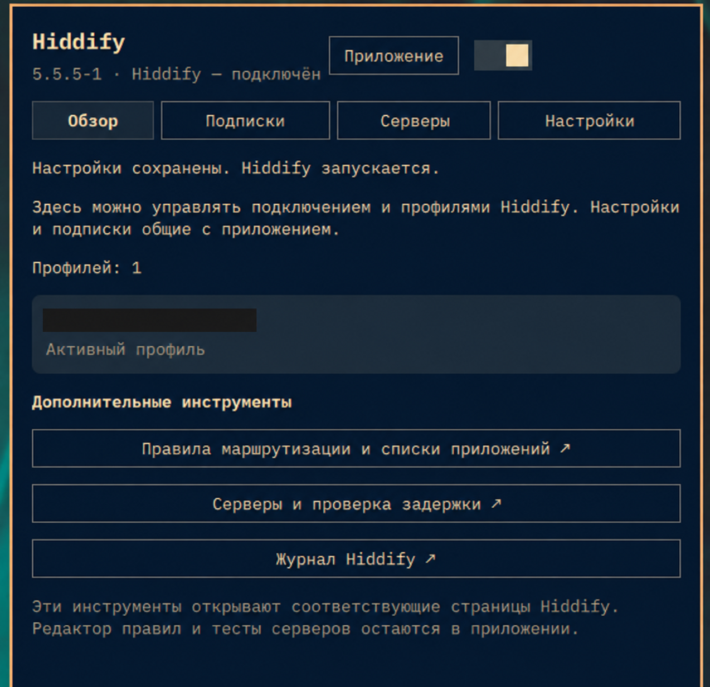

# Hiddify for Omarchy

[Русский](README.ru.md) · English

A Hiddify control panel for the Omarchy Quickshell bar. Connect or disconnect, import subscriptions, choose servers and edit 86 settings from one panel.



## Features

- Explicit connection action and live status, with Proxy, System proxy, VPN and Router quick modes.
- Compact overview, expanded settings, and Open app / Minimize actions.
- HTTPS subscription import and refresh, validated by the installed Hiddify CLI.
- Active-profile selection, server selection and latency tests.
- Searchable settings for DNS, TUN, ports, routing, TLS fragmentation, WARP, Psiphon and the app.
- Private backups before settings/profile writes and a restore action.
- Russian and English labels, options, plural forms, numbers and dates.
- Automatic Hiddify installation from a verified official release in a visible terminal.
- Quiet background refresh: stable controls and preserved settings scroll position.
- Hourly release checks, one notification per new Hiddify version and a manual check/update action.

## Install

Requires Omarchy Quattro, Python 3 and a supported Hiddify version for native settings/profile writes. The shipped core bridge targets Linux x86_64. Hiddify itself is installed separately through the package manager; its runtime is not bundled in this repository.

```bash
omarchy plugin add https://github.com/AmirAdelevich/omarchy-hiddify --enable
```

The plugin ID is `msi.hiddify`. Left-click its bar icon to open the panel; right-click to connect or disconnect in the selected mode. The Minimize button hides the Hiddify window, and Open app restores it. First installation and updates use the same official GitHub AppImage and verified Arch-package build. Enter any requested password in the installer terminal.

## Update

Select **Update extension** on the panel’s Home tab. On devices with an older version, run:

```bash
omarchy plugin update msi.hiddify --yes
```

The Minimize action moves Hiddify windows to a dedicated hidden Hyprland workspace. Open app returns them to the current workspace.

## Language

The plugin follows the live language selected in **Omarchy Setup → Language**. If no Omarchy language has been selected, it uses `LC_ALL`, `LC_MESSAGES`, `LANGUAGE`, then `LANG`. Russian locales select Russian; English and other locales use English. No shell restart is required when changing the Omarchy language.

All 86 preference labels and supported choice labels have Russian and English text. Technical keys, protocol names and user-supplied server/profile names remain as entered.

## Data changes and compatibility

The preferences catalog is verified against Hiddify 5.9.2. Native writes support Hiddify 5.5.5, 5.9.0, 5.9.1 and 5.9.2 with the verified v7 profile database schema. Other versions or schemas are refused before writing.

**Apply, subscription import/refresh, profile activation and restore close Hiddify gracefully and restart it. The VPN can disconnect.** Each button identifies this behavior. A backup is made before a write, and writing is refused while the GUI still runs. Other preferences are preserved, and conflicting edits made in Hiddify are detected.

Advanced routing rules, full logs and system autostart are accessed through the native Hiddify pages. This widget does not replace every native app screen. WARP's structured settings are JSON strings; per-app lists use `;` separators.

Complete snapshots include the profile database, preferences and every profile configuration. Writes leave a recovery journal until all files are committed. If a process is interrupted, use Recover data with Hiddify closed. Legacy backups remain readable.

For an AppImage VPN session, Hiddify can keep its active service key only in memory. If the installed-service API is inactive and the saved Clash API key is rejected, the plugin opens the native server list. It does not attempt to bypass authentication.

## Network, credentials and dependencies

Runtime dependencies: Omarchy Quickshell and its `qs.Ui`/`qs.Commons` components, Python 3 standard library, Hiddify and its HiddifyCli, Hyprland’s hyprctl, makepkg, and the usual Omarchy package-management tools. The Go bridge is included with source and pinned build dependencies in `corebridge/go.mod` and `corebridge/go.sum`.

External requests occur on installation, explicit subscription import/refresh, or explicit latency tests. HTTPS subscriptions are limited to 8 MB; HTTP redirects are refused and download/parser timeouts are applied. Hiddify performs latency checks through its configured test destination. Local state is refreshed every five seconds while the panel is open. Automatic update checks query the fixed HTTPS endpoint `api.github.com/repos/hiddify/hiddify-app/releases?per_page=20` once an hour, including while the panel is closed. Disable these checks with the Hourly switch in Overview. The latest version and notification history are kept privately in `updates.json` under the plugin state directory. Each new version produces one popup across monitors and restarts. When current, the panel displays that no updates are available. Checks include numbered pre-releases. The version label identifies releases and pre-releases. The updater closes Hiddify through its native Quit action and waits for it to exit. It relaunches the app afterward. The widget resumes a connection that was active before updating. The installer preserves the installed package name and selected connection mode. The Update button builds and installs an Arch package from the official AppImage in a terminal, checking the SHA-256 supplied by GitHub.

Server controls use Hiddify's local background core at `127.0.0.1:18020` and its existing `/var/lib/hiddify-admin-bgservice/control.secret`. This credential is read locally, never logged or uploaded. Before gRPC can send its authorization metadata, the custom dialer checks the kernel UID of the exact established reverse TCP tuple in `/proc/net/tcp`. Only a root-owned peer is accepted. Every new connection, including reconnects, passes this check. The connection is closed on missing or untrusted ownership information. Root and the current user are trusted local identities. A local Clash API is used as a fallback if its token is available, with the same connected-socket ownership check accepting root or the current user before HTTP headers are written. Credentials are never forwarded through an HTTP proxy or redirect. The native server page remains available when neither API can be used.

Hiddify data is under `$XDG_DATA_HOME/app.hiddify.com/` (default `~/.local/share/app.hiddify.com/`). Private backups and staged imports are under `$XDG_STATE_HOME/omarchy-hiddify/` (default `~/.local/state/omarchy-hiddify/`), with private directory/file permissions. Subscription URLs are sent to the adapter on stdin, not process arguments.

## Disable or remove

```bash
omarchy plugin disable msi.hiddify
omarchy plugin remove msi.hiddify
```

Removing the plugin preserves Hiddify, its subscriptions/settings and the backups. Hiddify remains usable through its native app. Backups can be removed separately from the state directory when no longer needed.

## IPC

```bash
omarchy-shell msi.hiddify open
omarchy-shell msi.hiddify close
omarchy-shell msi.hiddify minimize
omarchy-shell msi.hiddify page subscriptions
omarchy-shell msi.hiddify page settings
omarchy-shell msi.hiddify page servers
omarchy-shell msi.hiddify status
```

## Build and test

```bash
python -m unittest discover -s . -p 'test_*.py'
node test.cjs
(cd corebridge && go test -race ./... && CGO_ENABLED=0 GOEXPERIMENT= go build -buildvcs=false -trimpath -ldflags='-s -w' -o ../corebridge-bin .)
omarchy plugin validate .
```

Go 1.27.4 or later is required to rebuild the bridge. Write/import tests use temporary databases and fixtures and never change the real VPN connection. Package installation is tested with stub commands.

## License and attribution

Plugin code: [MIT](LICENSE). Go dependency licenses are in [licenses/](licenses/). This is an independent integration for [Hiddify](https://github.com/hiddify/hiddify-app) and [Omarchy](https://github.com/omacom/omarchy), not an official Hiddify or Omarchy release.

Preference keys, supported values and native tray action labels were checked against Hiddify app v5.9.2; local gRPC message fields follow hiddify-core's `v2/hcore/hcore.proto`. The adapter and its labels are implemented in this repository. No Hiddify application or core source is compiled into the bridge: the bridge uses the local protocol to communicate with the separately installed application. The supplied preview is an English promotional composition based on a screenshot of this plugin, with an example profile.
