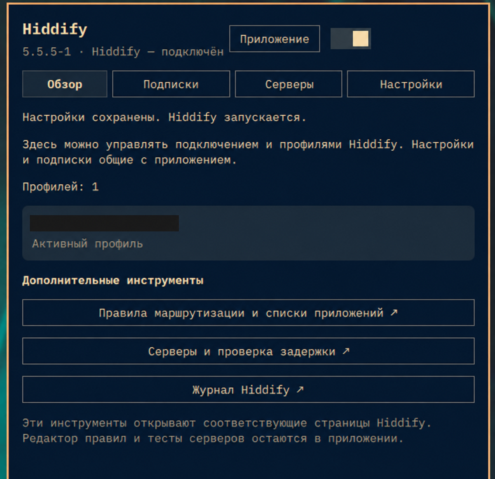

# Hiddify for Omarchy — msi.hiddify 2.3.1

Панель Quickshell с общей базой профилей и настройками установленного Hiddify.



- ЛКМ открывает панель, ПКМ включает или выключает подключение в выбранном режиме. «Свернуть» скрывает окно Hiddify, «Приложение» возвращает его.
- Обзор подключения и выбор активного профиля.
- Импорт HTTPS-подписок (включая `hiddify://import/?url=…`) и обновление существующих.
- Валидация подписки настоящим HiddifyCli, прежде чем закрывать приложение или менять профили.
- Выбор серверов и тест задержки через локальное ядро Hiddify; резервный путь через Clash API.
- 86 параметров с поиском: приложение, DNS, TUN, порты, маршрутизация, TLS/fragmentation, WARP/Psiphon.
- Резервные копии перед записью и восстановление последней копии.
- Первая установка и обновления используют официальный AppImage с проверкой SHA-256 и установкой через Arch-пакет в видимом терминале.
- Русский и английский интерфейс; тема и анимации Omarchy.

## Совместимость и ограничения

Каталог настроек проверен по исходникам Hiddify 5.9.2. Запись поддерживает версии 5.5.5, 5.9.0, 5.9.1 и 5.9.2 с проверенной схемой базы профилей v7. Неизвестная версия или схема блокирует запись. Поставляемый corebridge-bin собран для Linux x86_64. Исходный Go-адаптер находится в corebridge/.

Сохранение настроек, импорт/обновление подписки, переключение профиля и восстановление закрывают Hiddify его штатным пунктом «Выход», ожидают завершения GUI и запускают его снова. **VPN может отключиться; подключение при необходимости включается кнопкой панели.** Одновременная запись с работающим GUI запрещена. Изменённые в самом приложении настройки обнаруживаются перед записью.

Редактор сложных правил маршрутизации, системный автозапуск приложения и некоторые системные операции не продублированы: для них используются полные страницы Hiddify. Панель не является полной заменой GUI. Структурные JSON-блоки WARP редактируются как JSON-строки; списки приложений разделяются `;`.

Управление серверами через gRPC доступно с фоновой VPN-службой Hiddify: только 127.0.0.1:18020 с её штатным control.secret. Секрет не копируется и не выводится в логи. При отсутствии фоновой службы используется loopback Clash API, если доступен его актуальный токен. Если ни один интерфейс недоступен, панель предлагает штатный список серверов.

## Данные и сеть

Рабочие данные Hiddify: `$XDG_DATA_HOME/app.hiddify.com/` (обычно `~/.local/share/app.hiddify.com/`). База профилей читается через SQLite, изменения выполняются транзакционно после завершения GUI. Копии и временные импорты: `$XDG_STATE_HOME/omarchy-hiddify/` (обычно `~/.local/state/omarchy-hiddify/`), каталог 0700, файлы 0600.

Внешняя сеть используется при установке, явном импорте/обновлении подписки и нажатии проверки задержки. Импорт: HTTPS, ограничение ответа 8 МБ, таймауты загрузки и конвертации; перенаправления на HTTP отвергаются. URL подписок передаются адаптеру через stdin, не через командную строку, и не отображаются в журналах. При открытой панели раз в 5 секунд читается локальное состояние. В закрытой панели периодического опроса нет. Проверки задержки выполняет ядро Hiddify по настроенному им адресу проверки связи.

## Установка плагина

Скопируйте runtime-файлы в `~/.config/omarchy/plugins/msi.hiddify/`:

```
manifest.json BarWidget.qml Language.qml Model.js backend.py catalog.json install.sh corebridge-bin i18n/
```

Затем:

```bash
omarchy plugin validate ~/.config/omarchy/plugins/msi.hiddify
omarchy-shell shell rescanPlugins
omarchy plugin enable msi.hiddify --section right --before omarchy.network
```

Обнаружение нового каталога асинхронное; при первом включении может потребоваться несколько секунд. QML-кэш при необходимости обновляется `omarchy restart shell`.

## IPC

```bash
omarchy-shell msi.hiddify open
omarchy-shell msi.hiddify close
omarchy-shell msi.hiddify toggle
omarchy-shell msi.hiddify page subscriptions
omarchy-shell msi.hiddify page settings
omarchy-shell msi.hiddify page servers
omarchy-shell msi.hiddify status
```

IPC намеренно не принимает URL подписок или пароли.

## Проверка и сборка

```bash
python -m unittest discover -s . -p test_backend.py
node test.cjs
(cd corebridge && go test ./... && go build -trimpath -ldflags='-s -w' -o ../corebridge-bin .)
omarchy plugin validate .
```

Тесты операций записи используют только временную базу, тестовую подписку и изолированные файлы; настоящее VPN-подключение не переключают. Установщик проверяется с подставными командами менеджера пакетов.

Каталог параметров получен из исходников Hiddify app v5.9.2 (https://github.com/hiddify/hiddify-app/tree/v5.9.2). Формат локального протокола: hiddify-core v2/hcore/hcore.proto. Зависимости Go зафиксированы go.mod/go.sum, их лицензии приложены в licenses/.

## Обновление

На вкладке «Главная» нажмите «Обновить расширение». На устройствах со старой версией выполните:

```bash
omarchy plugin update msi.hiddify --yes
```

## Язык интерфейса

Плагин автоматически следует настройке «Язык» в Omarchy. Если настройка отсутствует, используются LC_ALL, LC_MESSAGES, LANGUAGE и LANG. Для русской локали выбирается русский, для остальных — английский. Переведены все 86 название настройки и варианты выбора; технические ключи и пользовательские имена не меняются.

## Удаление

```bash
omarchy plugin disable msi.hiddify
omarchy plugin remove msi.hiddify
```

Hiddify, его профили и резервные копии сохраняются. Лицензия плагина — MIT; лицензии Go-зависимостей находятся в licenses/.


## Проверка обновлений Hiddify

В «Обзоре» есть проверка релизов Hiddify раз в час. Она работает и при закрытой панели. Переключатель «Раз в час» отключает автоматические запросы. Кнопка «Проверить сейчас» выполняет ручную проверку. Источник — фиксированный HTTPS-адрес официального GitHub Hiddify.

Каждая новая версия вызывает одно всплывающее уведомление. Запись об уже показанной версии хранится в приватном updates.json и учитывается при перезапуске и на нескольких мониторах. При актуальной версии панель показывает «У вас установлена последняя версия. Обновлений нет». Кнопка «Обновить Hiddify» запускает менеджер пакетов в терминале.

## Проверка владельца локального соединения

Перед передачей секрета gRPC-адаптер проверяет через /proc/net/tcp, что серверная сторона уже установленного TCP-соединения принадлежит root. Проверяется точная обратная пара адресов и портов. Проверка повторяется для каждого нового соединения. Для резервного HTTP API проверяется root или текущий пользователь до отправки заголовка Authorization. При невозможности подтвердить владельца соединение закрывается.

Проверка учитывает предварительные релизы с номером версии. Обновление скачивает официальный AppImage, проверяет SHA-256 из GitHub и устанавливает его через Arch-пакет в терминале.

Быстрые настройки на главной переключают «Прокси», «Системный прокси», «VPN» и «Роутер» через штатное меню Hiddify. Кнопка подключения показывает действие и режим. «Свернуть» перемещает окно в отдельное скрытое рабочее пространство Hyprland, «Приложение» возвращает его на текущее. Главная компактная, настройки раскрываются по высоте. Превью — английская композиция на основе скриншота с вымышленным профилем.

Полная резервная копия включает настройки, базу и файлы конфигураций профилей. Журнал позволяет восстановить данные после прерванной записи кнопкой «Восстановить данные» при закрытом Hiddify. Старые копии также читаются.

AppImage может хранить ключ активной VPN-службы только в памяти. Если API установленной службы неактивен, а ключ Clash API отклонён, доступен переход в штатный список серверов Hiddify.
